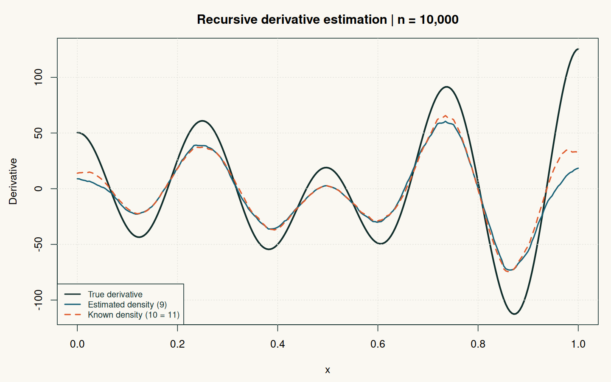

# Estimer une dérivée sans imposer de modèle paramétrique

**Statistiques non paramétriques · R · Simulation Monte-Carlo**

Comment estimer la variation locale d'une fonction de régression à partir d'observations bruitées ? Ce projet implémente et compare **trois estimateurs récursifs à noyau de sa dérivée**, d'après les travaux de Bercu, Capderou et Durrieu (2019).

Travail universitaire d'**Amadou Bocoum et Anya Levêque**, M1 Data Science et Modélisation Statistique, Université Bretagne Sud, décembre 2025.



## Question et démarche

Le modèle simulé est `Y = f(X) + epsilon`, avec `X` uniforme sur `[0, 1]` et un bruit normal standard indépendant. La fonction oscillante et sa dérivée analytique sont connues : elles servent de références pour mesurer l'erreur, pas de données réelles.

- Trois estimateurs : dérivée d'un quotient avec densité estimée (équation 9), densité connue (10), pondération par la densité connue (11).
- Trois noyaux : Epanechnikov, quartique/biweight (nommé « quadratique » dans le travail original), gaussien.
- Une fenêtre propre à chaque observation, `h_i = i^(-alpha)`.
- Une comparaison par erreur quadratique, biais et variabilité Monte-Carlo.

## Reproduire une expérience vérifiée

R de base suffit. Depuis la racine du dépôt :

```sh
Rscript scripts/reproduce.R
```

Ce script utilise **les fonctions du R Markdown original**, sans lancer ses simulations coûteuses ni son balayage de fenêtres. Il vérifie la dérivée analytique par différences finies, l'intégrale des noyaux, ainsi que l'identité des estimateurs 10 et 11 lorsque la densité est uniforme.

L'expérience complémentaire utilise une graine fixe, 10 000 observations, 200 répétitions, `alpha = 0,3` et les points `x = 0,5` et `x = 0,8`. Les mêmes observations sont utilisées pour comparer les méthodes dans une répétition. Elle exporte **MSE, biais non recentré et erreur standard Monte-Carlo de la MSE**. Elle ne prétend pas reproduire à l'identique les tirages ou les tableaux du rapport.

| Livrable | Contenu |
|---|---|
| [Code original](analysis/coursework.Rmd) | Analyse universitaire complète, conservée à l'identique |
| [Rapport](reports/coursework.pdf) | Étude théorique et simulations du projet |
| [Script de reproduction](scripts/reproduce.R) | Vérifications et expérience complémentaire |
| [Résultats CSV](results/monte-carlo.csv) | Résultats réellement recalculés par le script |
| [Configuration](results/config.txt) | Taille, répétitions, graine, fenêtre et version de R |

Testé avec R 4.3.3. Pour compiler le notebook complet, `knitr`, `rmarkdown` et une installation LaTeX sont nécessaires. Son calcul leave-one-out est quadratique et peut être long ; le script ci-dessus est le point d'entrée recommandé.

## Ce que les résultats permettent de dire

La précision dépend du noyau, du point étudié et de la fenêtre. Une simulation permet d'illustrer ce compromis, pas d'affirmer qu'un noyau domine dans tous les cas. Sous la densité uniforme choisie ici, les estimateurs 10 et 11 sont identiques lorsqu'ils utilisent les mêmes observations : leur accord n'est pas une validation indépendante.

### Précisions sur le rapport original

- Le critère appelé « validation croisée » compare les estimations à la **dérivée vraie `fprime`**. Conforme au sujet universitaire, c'est un **critère oracle en simulation**, indisponible tel quel sur des données réelles.
- `alpha = 0,3` est une valeur retenue sur la grille étudiée, pas un optimum universel ; elle se trouve à la borne supérieure de cette grille.
- Les histogrammes du rapport sont recentrés empiriquement. Ils illustrent la forme des erreurs mais masquent leur biais, d'où l'export du biais non recentré ici.
- Une courbe à une taille d'échantillon donnée ne prouve ni la convergence presque sûre ni la normalité asymptotique. Ces propriétés relèvent des résultats théoriques et de leurs hypothèses.
- Les effets de bord et les zones où une densité estimée est faible demandent une attention particulière. Le script ne constitue pas une bibliothèque statistique générale.

## Reférences
Référence étudiée : Bernard Bercu, Sami Capderou et Gilles Durrieu, [*Nonparametric recursive estimation of the derivative of the regression function with application to sea shores water quality*](https://doi.org/10.1007/s11203-017-9169-1)..
